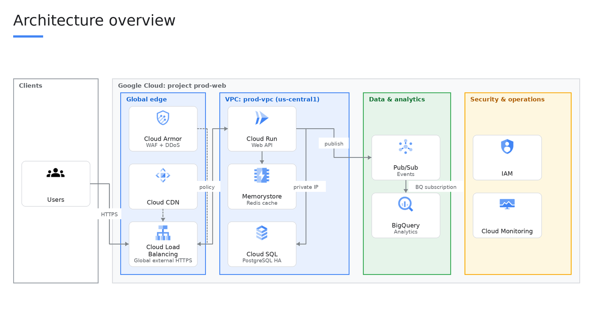
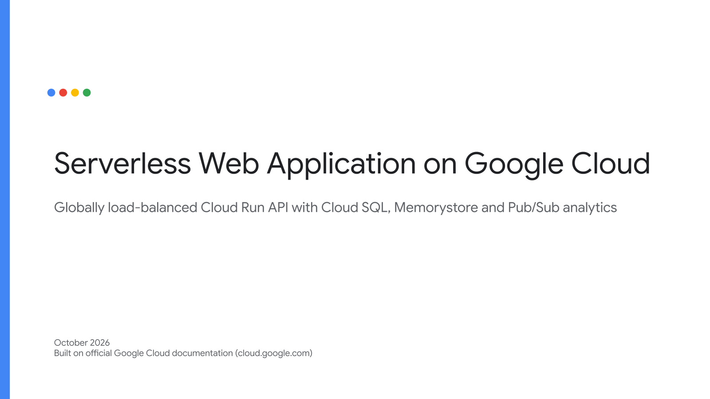
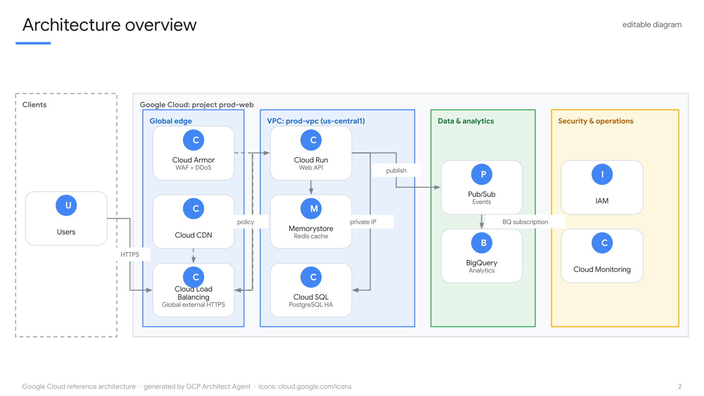
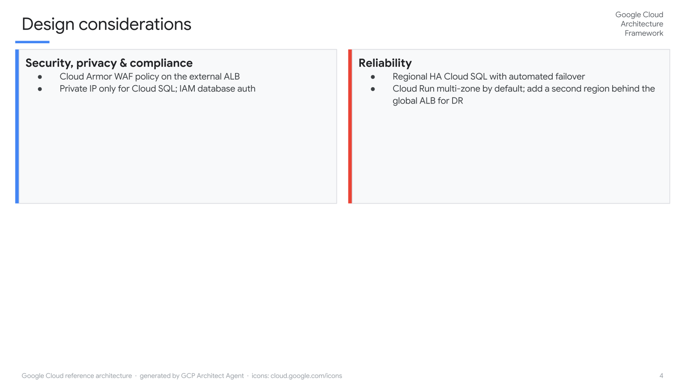

# gArchi — GCP Architect Agent

**Rapid, clean, repeatable Google Cloud architecture decks — unique to each customer.**

gArchi is a locally hosted Gemini agent (built on the [Agent Development Kit](https://google.github.io/adk-docs/))
for **Customer Engineers and Cloud Architects**. Describe a customer's workload and constraints
in plain language; get back an **editable Google Slides deck** with an architecture diagram drawn
from the **official Google Cloud icons**, a component table linked to **official documentation**,
Architecture Framework design considerations — and, on request, a **variablized Terraform project**
for the same design.



---

## Table of contents

1. [Why gArchi](#why-garchi)
2. [Use cases](#use-cases)
3. [What you get](#what-you-get)
4. [How it works](#how-it-works)
5. [Quick start](#quick-start)
6. [Setup details](#setup-details)
7. [Working with the agent](#working-with-the-agent)
8. [Terraform generation](#terraform-generation)
9. [Developing](#developing)
10. [Repository layout](#repository-layout)
11. [Roadmap](#roadmap)
12. [FAQ](#faq)

---

## Why gArchi

Customer Engineers draw the same classes of architecture over and over — serverless web apps,
data platforms, GKE landing zones, hybrid connectivity, GenAI/RAG apps — but every customer needs
*their* version: their regions, compliance regime, existing systems, naming, and emphasis.
Doing that by hand in Slides costs hours per opportunity and produces inconsistent output.

gArchi's purpose is to make that **minutes instead of hours** while raising the floor on quality:

| Goal | How gArchi delivers it |
|---|---|
| **Rapid** | One prompt → full deck. Iterate by chat ("make it multi-region", "swap Cloud SQL for AlloyDB"); the same deck is rebuilt in place. |
| **Clean** | Deterministic layout engine, Google Cloud palette, official product icons, consistent typography — every deck looks like it came from the same team. |
| **Repeatable** | The design is a structured spec (zones / nodes / edges / components / considerations), so patterns can be reused and tweaked, not redrawn. |
| **Unique to the customer** | Requirements (scale, SLA/RTO/RPO, compliance, regions, on-prem/SaaS integrations) drive product choices, zone labels, configuration notes and the design-considerations slide. |
| **Trustworthy** | Grounded in official `cloud.google.com` documentation (Architecture Center, Architecture Framework, product docs); every component links to its docs; the agent separates documented facts from recommendations. |
| **Editable** | Everything is a native Slides object: shapes, bound connectors (arrows follow when you move a card), images, tables. No embedded pictures of diagrams. |

---

## Use cases

**Discovery → first-call deck.** Paste the notes from a discovery call; get a reference
architecture with assumptions and open questions listed, ready to validate with the customer.

**Pattern tailoring.** Start from a standard pattern (serverless web app, lakehouse, GKE
multi-region, hybrid with Interconnect, RAG on Vertex AI) and specialise it: EU data residency,
PCI scope, existing Okta IdP, SAP on-prem, 5k TPS.

**Design alternatives.** Ask for two variants (e.g. Cloud Run vs GKE, Cloud SQL vs Spanner) and
get two decks with the trade-offs spelled out against the Architecture Framework pillars.

**Workshop and POC hand-off.** Generate the deck for the design workshop, then
"generate the Terraform" to hand the POC team a variablized, documented starting point where
adding an instance is a `tfvars` entry.

**Keeping decks current.** Re-open last quarter's spec, change what changed, re-render — same
URL, same look.

Example prompts:

> *Design a PCI-compliant payments API for a European retailer: 5k TPS peak, RPO 0 / RTO 15 min,
> SAP on-prem via Interconnect, Okta for workforce SSO. Two regions in the EU.*

> *Lakehouse for a media company: 20 TB/day clickstream from Pub/Sub, batch loads from S3,
> BigQuery as the warehouse, Looker for BI, Dataplex governance, CMEK everywhere.*

> *Internal GenAI assistant over Confluence and Drive content with Vertex AI Search, Gemini on
> Vertex AI, IAP in front, VPC Service Controls. Show the data flow and the security boundary.*

---

## What you get

| Slide | Content |
|---|---|
| **Cover** | Title, one-line summary, customer, date |
| **Architecture overview** | Editable diagram: nested zones (project / VPC / data / security / external / on-prem), product cards with official icons, bound connectors with protocol labels |
| **Components** | Product · role in this design · key configuration · link to official docs |
| **Design considerations** | Cards per Architecture Framework pillar (security, reliability, cost, operations, performance, AI/ML) |
| **References** | The official pages used |

<p>
  
  
  
</p>

*Live Google Slides renders of the example spec (middle image is the icon-less test mode used in CI).*

Plus, on request, a **Terraform project** (`providers.tf`, `backend.tf`, `variables.tf`,
`terraform.tfvars`, `main.tf`, `outputs.tf`, `README.md`) — see [Terraform generation](#terraform-generation).

---

## How it works

```
you ──chat──▶ gcp_architect  (Gemini 3.8 Flash · ADK · thinking=high)
                │
                ├─ search_gcp_docs            sub-agent with Google Search grounding, restricted to cloud.google.com
                ├─ fetch_official_doc         read a cloud.google.com page before quoting limits / SLAs / editions
                ├─ list / search / get_gcp_product   curated catalog: product → official docs URL + official icon id
                ├─ validate_architecture_spec layout dry-run (node count, scale, unknown products)
                ├─ render_architecture_deck   spec → Google Slides batchUpdate (native, editable objects)
                └─ Terraform tools            scaffold · official provider docs · write + lint · read
```

1. **Understand** — the agent extracts goal, workload, scale, availability targets, compliance,
   regions, integrations; asks at most 2–3 questions if something critical is missing, otherwise
   states assumptions and proceeds.
2. **Ground** — researches patterns and product facts in official docs only.
3. **Design** — managed services first; applies the enterprise baseline (resource hierarchy, Shared
   VPC / hub-and-spoke, private connectivity, Cloud Armor + global LB, least-privilege IAM, CMEK where
   required, observability, CI/CD, backup/DR, cost controls).
4. **Specify** — emits a structured `ArchitectureSpec` (zones, nodes, edges, components,
   considerations, references) using catalog product ids.
5. **Render** — deterministic layout → Slides API requests → deck URL + thumbnail.
6. **Iterate** — changes modify the spec and rebuild the same deck.

---

## Quick start

Prerequisites: glinux or a Chromebook Linux container with Python ≥ 3.11 (`python3-venv`),
`gcloud`, and a Google Cloud project you own with billing (Vertex AI, Slides/Drive APIs, one small
bucket for icons). Don't have a project yet? See [FAQ](#faq).

```bash
git clone git@github.com:ngentil-sys/gArchi.git gcp-architect-agent
cd gcp-architect-agent
./scripts/setup.sh        # venv, .env, gcloud login with Slides scopes, APIs, official icons → bucket, tests
./scripts/run.sh          # ADK dev UI → http://127.0.0.1:8000, choose "gcp_architect"
```

---

## Setup details

### Configuration (`gcp_architect/.env`)

| Variable | Purpose | Default |
|---|---|---|
| `GOOGLE_GENAI_USE_VERTEXAI` | Use Vertex AI for Gemini | `TRUE` |
| `GOOGLE_CLOUD_PROJECT` / `GOOGLE_CLOUD_LOCATION` | Project / region for Vertex AI | — / `us-central1` |
| `ARCHITECT_MODEL` / `ARCHITECT_THINKING_LEVEL` | Architect model and thinking level | `gemini-3.8-flash` / `high` |
| `RESEARCHER_MODEL` / `RESEARCHER_THINKING_LEVEL` | Docs-research sub-agent | `gemini-3.8-flash` / `low` |
| `ICON_HOST` | `gcs` \| `url` \| `none` | `gcs` |
| `ICON_BUCKET` / `ICON_PREFIX` | Bucket holding the official icon PNGs | — / `icons/` |
| `ICON_SIGNER_SA` | Service account for signed URLs (private bucket) | unset |
| `ICON_BASE_URL` | Static host alternative | unset |
| `SHARE_DECKS_WITH` | Comma-separated users to share every deck with | unset |
| `OUTPUT_DIR` / `TERRAFORM_BIN` | Terraform output folder / binary for `fmt`/`validate` | `./output` / auto |

### Why a bucket for icons?

The Slides API inserts images **by public URL** (PNG/JPEG/GIF, no auth, no SVG). `setup_icons.py`
downloads the official pack from <https://cloud.google.com/icons>, mirrors the PNGs to
`gs://<ICON_BUCKET>/icons/` and makes them readable. If your organisation policy forbids public
buckets (typical for google.com projects), keep it private and set `ICON_SIGNER_SA`; the agent mints
short-lived V4 signed URLs via IAM `signBlob` (`--signer … --create-signer` creates the SA and grants
you `roles/iam.serviceAccountTokenCreator`). Generic non-GCP nodes (users, on-prem, SaaS) use
Google's Apache-2.0 Material icons.

### Cloudtop (glinux) notes

- `gcloud` lives at `/google/data/ro/teams/cloud-sdk/gcloud` if not on `PATH` (`export GCLOUD=…`).
- Over SSH there is no browser: the script uses `--no-launch-browser`; open the URL on your laptop and
  paste the code back. Already logged in? `SKIP_LOGIN=1 ./scripts/setup.sh`.
- The UI binds to `127.0.0.1:8000`: use Chrome Remote Desktop or
  `ssh -L 8000:localhost:8000 <you>.c.googlers.com`.

---

## Working with the agent

Good inputs include: business goal, workload type, users and scale, latency/availability targets
(SLA, RTO/RPO), data classification and compliance, regions, integrations (on-prem, other clouds,
SaaS, IdP), team constraints and budget sensitivity. The agent will state what it assumed.

Useful follow-ups:

- "Make it multi-region active/passive with RTO 15 min."
- "Add Apigee in front and move the API to GKE Autopilot."
- "Show the CI/CD and observability path on a second diagram."
- "Generate the Terraform."
- "Why Spanner over Cloud SQL here? Cite the docs."

The agent flags products that have no dedicated official icon yet (e.g. AlloyDB uses the closest
icon) so you can adjust that card by hand.

---

## Terraform generation

Ask *"generate the Terraform"* after a design. Output: `output/<slug>/terraform/`

| File | Purpose |
|---|---|
| `providers.tf` | `terraform` + `hashicorp/google` and `google-beta` pinned to the latest minor at generation time |
| `backend.tf` | GCS remote state via `-backend-config` |
| `variables.tf` | Typed, documented, validated inputs — core (`project_id`, `region`, `environment`, `labels`, `enabled_apis`, `deletion_protection`) plus one **map variable per component** |
| `terraform.tfvars` | Environment values; every instance of a resource is an entry here |
| `main.tf` | `locals`, API enablement, then one section per component |
| `outputs.tf` | Endpoints / identifiers for other stacks |

Design rules enforced by the linter (the agent must reach `ok: true`):

- **Every resource is `for_each` over a `map(object({...}))` variable** — never `count`, never a
  singleton. Adding a service, bucket or database is a new `tfvars` entry, not new HCL.
- **No literals** for project ids, regions, zones, names, CIDRs, machine types, images, or secrets.
- Every `var.*` is declared; every variable without a default is set in `tfvars`.
- Secure defaults: private IP, uniform bucket-level access, `deletion_protection = var.deletion_protection`,
  least-privilege service accounts, Secret Manager for secrets.
- Every resource block is written **after reading the official provider documentation** for that
  resource (`hashicorp/terraform-provider-google` docs = what registry.terraform.io renders), so
  argument names are real. If `terraform` is installed, `fmt` and `validate` run as well.

---

## Developing

```bash
.venv/bin/python -m pytest -q                       # 16 tests: Slides schema validation, layout, routing, catalog, Terraform lint
.venv/bin/python scripts/preview_diagram.py         # local PNG preview of the example spec (no API needed)
.venv/bin/python scripts/preview_diagram.py my.json -o out.png
.venv/bin/python scripts/render_example.py          # real deck end-to-end (needs auth)
.venv/bin/python scripts/check_setup.py             # diagnose credentials / icons / config
```

Tests validate every generated Slides request against the bundled Slides v1 discovery schema, so
most API mistakes are caught offline. CI runs the suite on every push.

Adding a product: append to `gcp_architect/catalog/products.json` (official `docs` URL, icon id from
the official pack) and, if it has Terraform support, to `catalog/terraform_resources.json`.

---

## Repository layout

| Path | Purpose |
|---|---|
| `gcp_architect/agent.py` | `root_agent` (architect) + `gcp_docs_researcher` sub-agent |
| `gcp_architect/prompts.py` | Method, enterprise baseline, spec schema, Terraform rules |
| `gcp_architect/tools.py`, `tools_terraform.py` | ADK function tools |
| `gcp_architect/catalog/products.json` | Product catalog: id, name, category, official docs, official icon, aliases |
| `gcp_architect/catalog/terraform_resources.json` | Product → Terraform resources, APIs, beta flag |
| `gcp_architect/diagram/spec.py` | `ArchitectureSpec` (zones / nodes / edges / components / considerations / references) |
| `gcp_architect/diagram/layout.py` | Deterministic zone-driven layout on the 720×405 pt page |
| `gcp_architect/diagram/routing.py` | Connector sites and label placement |
| `gcp_architect/diagram/slides_builder.py` | Spec → Slides `batchUpdate` requests (native, editable) |
| `gcp_architect/diagram/icons.py` | Icon id → public URL (public / signed / static), reachability probe |
| `gcp_architect/diagram/render.py` | Create or rebuild a deck, retries, sharing, thumbnail |
| `gcp_architect/gapi/` | ADC auth with Workspace scopes, Slides/Drive client |
| `gcp_architect/terraform/` | Official provider docs fetcher, scaffold, linter, project I/O |
| `scripts/` | `setup.sh`, `run.sh`, `setup_icons.py`, `preview_diagram.py`, `render_example.py`, `check_setup.py` |
| `tests/` | Offline test suite |

---

## Roadmap

- [ ] Evaluation suite (`adk eval`) of standard CE briefs: trajectory + spec quality gates
- [ ] Design-review sub-agent (Architecture Framework critique before rendering)
- [ ] Speaker notes, legend, multi-view diagrams (context / network / data / CI-CD), IaC slide
- [ ] Vertex AI Search datastore over cloud.google.com for higher-precision grounding
- [ ] Terraform: module layout, per-environment tfvars, `tflint`/`checkov` gates, golden tests
- [ ] Packaging for Chromebook; FastAPI + chat UI; Agent Engine deployment for team use

---

## FAQ

**I'm new and don't have a GCP project.** Options for Googlers: a Nexus *Experimental* project
(go/internal-gcp-project-creation; fastest, google.com org policies apply → use the private-bucket
icon mode), an Argolis environment (go/argolis; customer-like org for Cloud GTM technical roles),
or your team's dev project.

**Can I use my own template / branding?** Not yet — the deck uses a neutral Google Cloud style.
Theme constants live in `diagram/slides_builder.py`; a template-based mode is on the roadmap.

**Does it draw AWS/Azure?** Nodes outside Google Cloud are drawn as generic "other cloud / on-prem /
SaaS" cards; the focus is the Google Cloud design.

**Is the Terraform production-ready?** It is a reviewed starting point: review `terraform plan`,
fill the `REPLACE_ME` values, and run your own policy checks before `apply`.

**Where do decks go?** Into the Drive of the account you authenticated with; set `SHARE_DECKS_WITH`
to auto-share.
